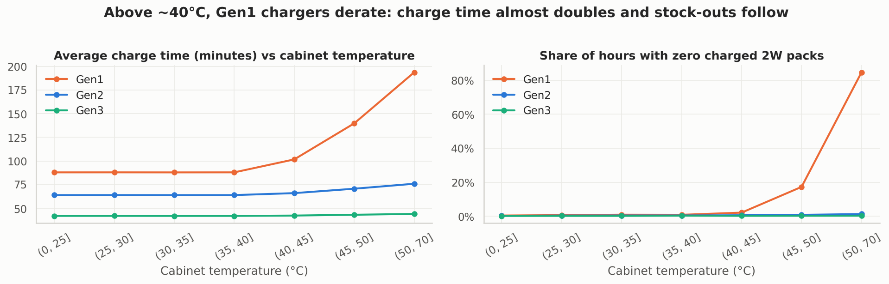
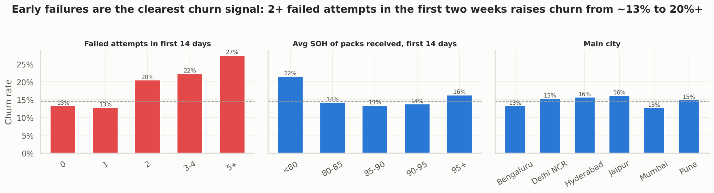
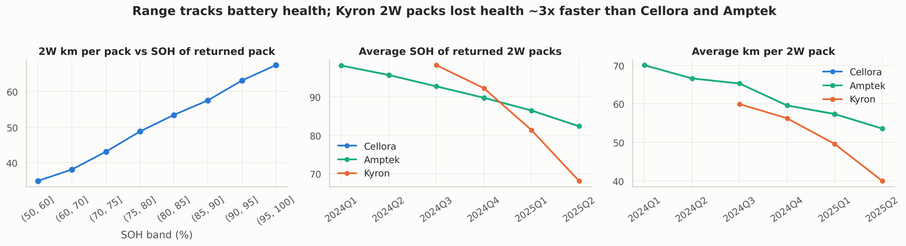
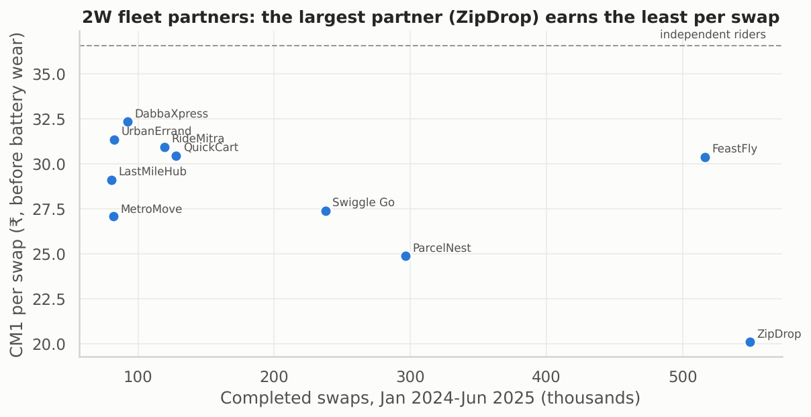

# VoltRelay Energy: what really drives service quality, retention and margin

Submission for the **Gradient Learnings Data Analytics Hackathon**. An analysis of 18 months (Jan 2024 to Jun 2025) of battery-swapping operations at VoltRelay, across 150 stations in six Indian cities.

- 📓 **Notebook:** [`VoltRelay_Analysis.ipynb`](VoltRelay_Analysis.ipynb) (runs top to bottom in Google Colab)
- 📖 **Story page:** [`voltrelay_story.html`](voltrelay_story.html) (download and open in a browser for the narrative version)
- 📊 **Figures:** [`figures/`](figures/)
- 🎬 **Demo video:** [`demo/voltrelay_demo.mp4`](demo/voltrelay_demo.mp4)

## Key findings

**1. Growth hid three separate problems.** Swaps and revenue roughly tripled, but failures spike to 10-12% every summer, complaints per attempt nearly tripled, and margin after battery wear fell back once a bad battery cohort arrived.

**2. Failures come from Gen1 chargers in hot cities.** Above about 40°C, Gen1 cabinets derate (charge time rises from 88 to 140-190 minutes), racks run out of charged packs, and "no charged battery" failures follow. The worst 30 stations are all Gen1 in Delhi NCR, Jaipur and Hyderabad, and they produce 42% of all failed attempts.

**3. Early failed swaps drive new-rider churn.** Two or more failed attempts in a rider's first two weeks more than doubles the odds they don't come back (odds ratio 2.2, after controls). This explains most of the Gen1 and summer effect.

**4. Kyron battery packs are eating margin.** Kyron 2W lots KY-2407/08/09 lose health about 3x faster than other suppliers, deliver about 25% less range, drive range complaints, and cost about ₹55 more in wear per swap. Retired Kyron packs were still being issued after their retirement date.

**5. ZipDrop is the largest partner but the least profitable per swap.** Its discount went from 12% to 28% and it is exempt from peak pricing, so it ranks last of 12 partners on margin per swap. The amendment cost about ₹3.7M in eight months with no extra growth.

**6. Pricing works where the payer sees the price.** The July 2024 price rise caused no measurable volume loss. The peak/off-peak pilot moved 2.5-4.5 points of demand off-peak, but not for surcharge-exempt partners.

## Recommendations

1. Fix or replace the 51 Gen1 chargers before next summer, starting with the 30 worst in Delhi NCR, Jaipur and Hyderabad.
2. Protect new riders' first two weeks: route them to Gen2/Gen3 stations and step in after a second failed swap.
3. Replace the Kyron 2W cohort and block retired packs from being issued.
4. Renegotiate ZipDrop toward a 10-15% discount instead of signing an exclusive deal.
5. Extend peak pricing to the hot cities once partner exemptions are removed.
6. Place future stations next to the Gen1 hot spots, not where sites are easiest to sign.
7. Fix the data pipeline issues found during cleaning (firmware time-zone bug, payment modes, retirement flags, ticket categories).

## Data

The dataset (eight tables, including `swap_events.csv.gz` and `station_hourly_status.csv`) was provided by the hackathon organizers and is **not included in this repo**, because the larger files exceed GitHub's 100 MB file limit. To rerun the notebook, upload the eight files into your Colab session (`/content`) or point `DRIVE_FOLDER` at a Google Drive folder that holds them, as described in section 1 of the notebook.

## Methods in brief

Data cleaning covers test stations, a firmware v3.2.0 timestamp shift (5h30m), offline-sync duplicates, city spellings, sensor outliers, missing telemetry and CSAT non-response bias. Margin is computed per completed swap as revenue minus energy, battery wear and site cost. Pricing effects use difference-in-differences against control cities, and churn drivers use logistic regression with controls for city, segment, vehicle class, channel, battery health and activity.
